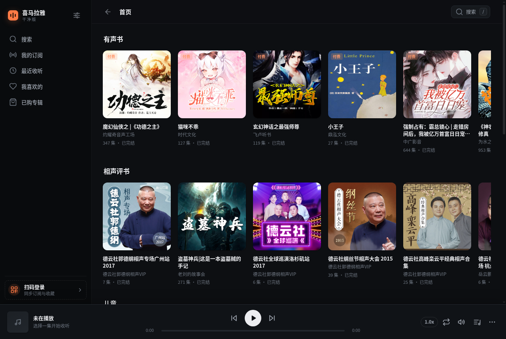
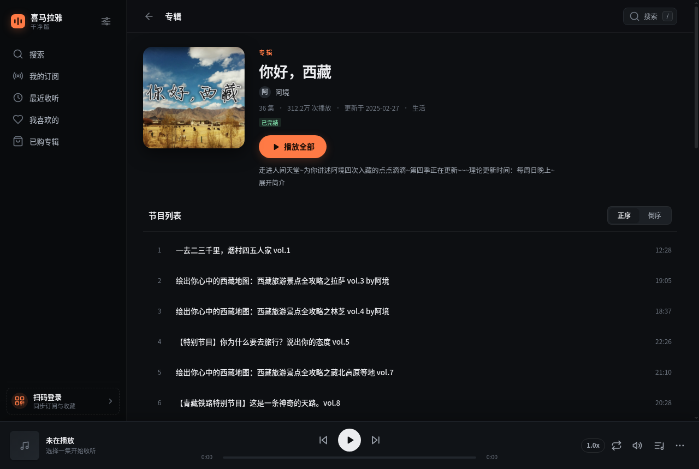
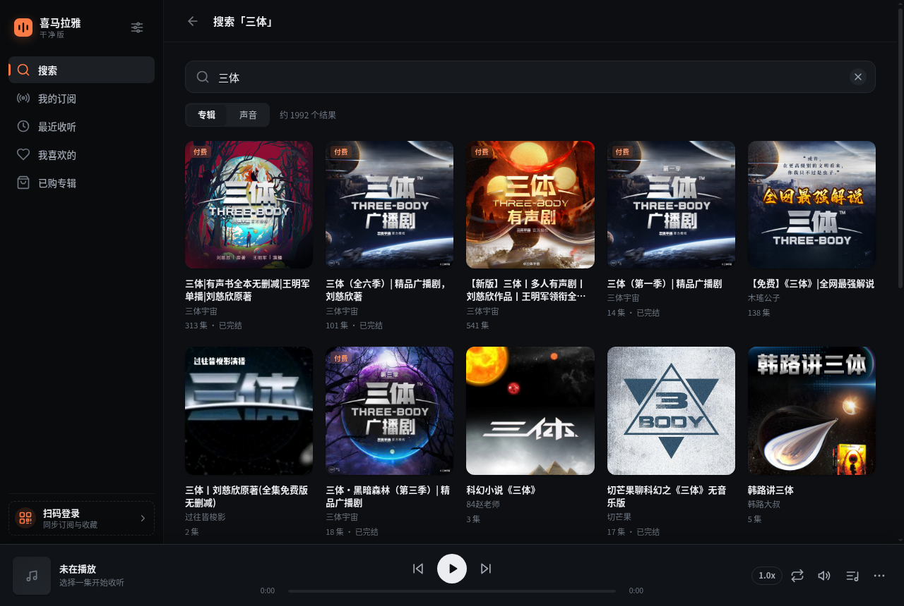
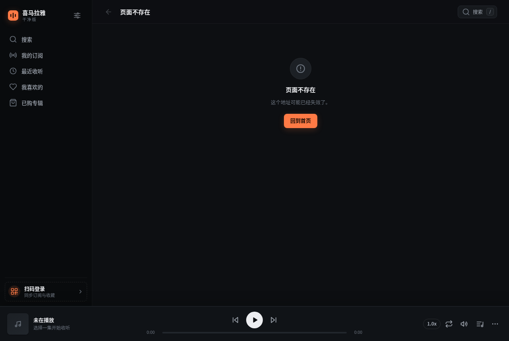

# 喜马拉雅 · 干净版 (ximalaya-clean)

一个跑在你自己电脑上的**开源**喜马拉雅听书客户端。没有开屏广告、没有贴片广告、没有信息流推荐轰炸，界面只留你真正在用的东西：搜索、订阅、专辑、播放。

和 [spotifast](https://github.com/crmne/spotifast) 的思路一样 —— 用干净的原生外壳去接一个满是广告的服务，只拿它真正的内容。

> **Linux 桌面端** · 零依赖 · 无需编译 · 数据只在你本机



## 特性

- **本机运行**：一个只监听 `127.0.0.1` 的本地服务 + 独立窗口，数据不经过任何第三方
- **无广告**：完全不加载喜马拉雅的播放器和广告脚本，只调用内容接口
- **登录自己的账号**：扫码登录后可以看订阅、最近收听、我喜欢的、已购专辑
- **听书友好**：倍速播放、睡眠定时、进度记忆、单集循环、硬件媒体键
- **零依赖**：不需要 `npm install`，不需要构建，不用编译原生模块
- **海外可用**：播放走移动端接口，绕过网页播放接口的 IP 限制（仍有部分内容受限，可配代理）

| 专辑页 | 搜索 |
|---|---|
|  |  |

## 安装

需要 **Node.js 20 或更高版本**。

```bash
git clone https://github.com/USER/ximalaya-clean.git
cd ximalaya-clean
./install.sh
```

安装后：

- 桌面和应用菜单里会出现「喜马拉雅 · 干净版」
- 终端里可以用 `xmly` 命令

> SteamOS / Arch 上如果没装 Node：`sudo pacman -S nodejs npm`
>
> 其他发行版：[nodejs.org](https://nodejs.org/) 下载，或用你自己的包管理器。

### 不安装，直接跑

```bash
./bin/xmly             # 启动（自动开独立窗口）
./bin/xmly --no-window # 只起服务，用浏览器打开 http://127.0.0.1:8787
./bin/xmly stop        # 停止
./bin/xmly status      # 查看状态
```

## 第一次使用

1. 启动后点左下角的「扫码登录」
2. 用手机喜马拉雅 App 扫二维码
3. 登录后左侧会多出「我的订阅 / 最近收听 / 我喜欢的 / 已购专辑」

不登录也能搜索、浏览专辑、听公开内容。

## 关于 VIP 和付费内容

登录后客户端会识别你的会员状态：

| 显示 | 含义 |
|---|---|
| 「VIP 会员免费」 | 你的会员可以直接听 |
| 「VIP 专享」 | 需要开通会员 |
| 「已购」 | 你买过这张专辑 |
| 「付费专辑」 | 需要单独购买 |

**不会绕过付费墙。** 没买的专辑、没开的会员，客户端只会如实告诉你需要什么，不会用其他手段获取内容。

> 「我的订阅」列表里不显示 VIP / 付费角标，因为那个接口不返回会员字段，逐张查询又太慢（30 张要 30 秒）。点进专辑页就能看到准确状态。

## 关于地区限制

喜马拉雅对**海外 IP** 有版权限制。本客户端已经做了处理：播放走移动端接口，绝大多数公开节目和已购内容在海外也能直接播放。

如果遇到确实被限制的内容，界面会提示。可以在 **设置 → 代理** 里填一个中国大陆的代理（支持 `http://` 和 `socks5://`），只影响客户端自己的请求，不改变系统网络设置：

```
http://127.0.0.1:7890
socks5://127.0.0.1:1080
```

填完点「测试代理」确认能连上，再回设置保存。



## 快捷键

| 键 | 作用 |
|---|---|
| `空格` | 播放 / 暂停 |
| `←` `→` | 快退 / 快进 10 秒 |
| `↑` `↓` | 音量 |
| `N` / `P` | 下一首 / 上一首 |
| `/` | 聚焦搜索框 |
| `Esc` | 关闭弹层 |

键盘上的媒体键（播放/暂停、上一首、下一首）也能用。

## 技术栈

- **后端**：Node.js 原生 `http` 模块，零 npm 依赖
- **前端**：原生 ES Module + 手写 CSS，无框架、无构建、无 CDN
- **图标**：内联 SVG
- **窗口**：Chrome / Chromium / Brave 的 `--app` 模式（独立窗口，没有地址栏）

项目结构：

```
server.js        HTTP 服务 + 路由 + 音频代理
lib/xm.js        喜马拉雅接口封装
lib/net.js       零依赖 HTTP 客户端（支持 HTTP / SOCKS5 代理）
lib/store.js     配置与登录信息持久化
public/          前端（原生 ES Module）
bin/xmly         启动器
install.sh       安装脚本
test/smoke.js    后端冒烟测试
```

跑测试：

```bash
./bin/xmly --no-window &
node test/smoke.js
```

## 数据存在哪

| 内容 | 位置 |
|---|---|
| 登录信息 | `~/.config/ximalaya-clean/cookie.json`（权限 600） |
| 设置 | `~/.config/ximalaya-clean/config.json` |
| 服务日志 | `~/.config/ximalaya-clean/server.log` |
| 界面偏好（音量、倍速、播放历史） | 浏览器 localStorage |

退出登录会删除 `cookie.json`。想彻底清干净，删掉 `~/.config/ximalaya-clean/` 即可。

## 常见问题

**窗口打不开 / 白屏**
先确认服务在跑：`./bin/xmly status`。如果没跑，看日志 `~/.config/ximalaya-clean/server.log`。

**没有 Chrome / Brave**
启动器会依次找 `google-chrome`、`chromium`、`brave-browser`，最后用 Flatpak 版 Chrome / Brave，都没有就用系统默认浏览器打开。

**想换端口**
编辑 `~/.config/ximalaya-clean/config.json` 里的 `port`，重启即可。

**播放到一半断了**
直链有时效，重新点一下播放会重新取地址。这是喜马拉雅的限制。

**提示「需要中国大陆网络环境」**
这条内容被版权方限制了，海外 IP 拿不到地址。在设置里配代理。

**突然变成未登录**
客户端会保护登录凭据（临时 Cookie 不会覆盖登录态，并且自动备份）。如果还是掉线了，重新扫码登录一次即可。备份在 `~/.config/ximalaya-clean/cookie.backup.json`。

## 卸载

```bash
./install.sh --uninstall
rm -rf ~/.config/ximalaya-clean    # 连登录信息和设置一起删
```

## 免责声明

本项目是**非官方**的个人使用工具，与喜马拉雅没有任何关系，也未获得其授权。

- 只调用公开的内容读取接口，**不绕过付费墙**：付费专辑仍然需要你在喜马拉雅官方渠道购买，VIP 内容仍然需要 VIP 会员
- 不修改、不破解、不重新分发任何受版权保护的内容
- 请遵守[喜马拉雅用户服务协议](https://www.ximalaya.com/)与当地法律法规
- 不要用于商业用途或批量抓取
- 使用本软件产生的任何后果由使用者自行承担

如果喜马拉雅官方认为本项目不妥，请提 issue，我会配合处理。

## 许可证

[MIT](LICENSE)
